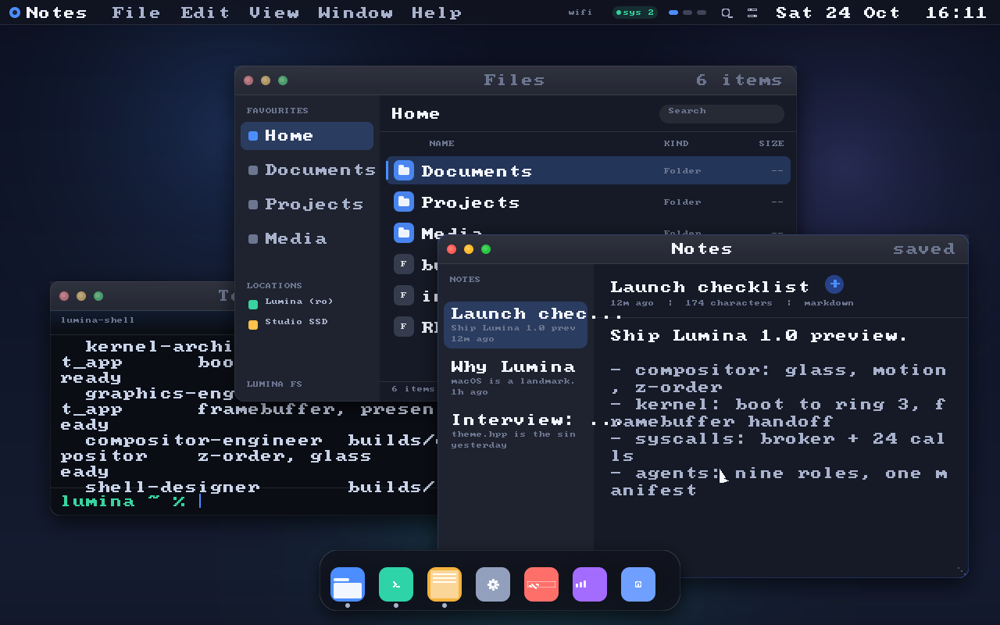
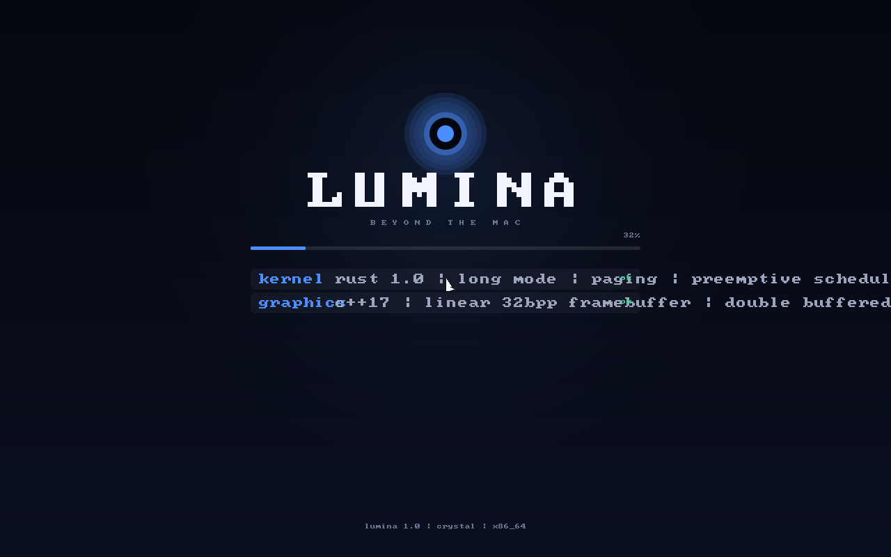
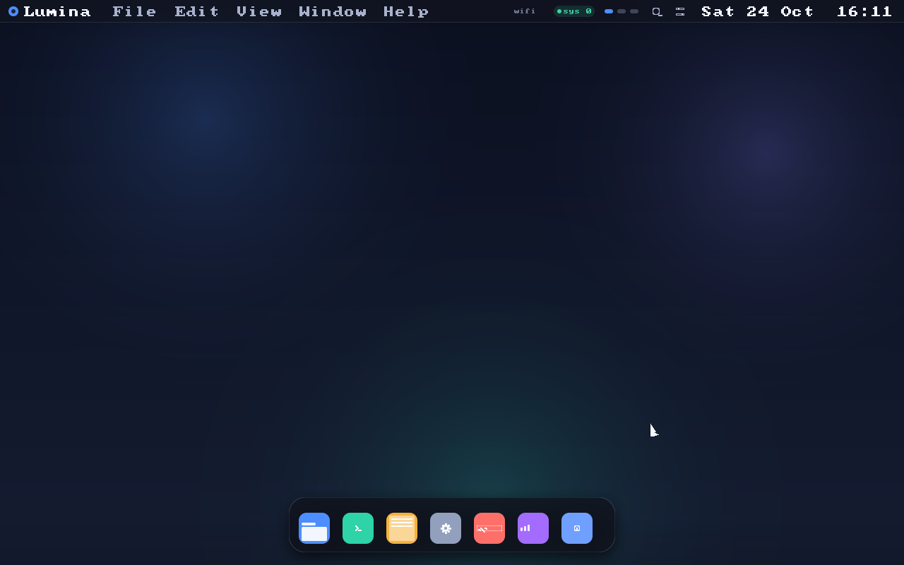
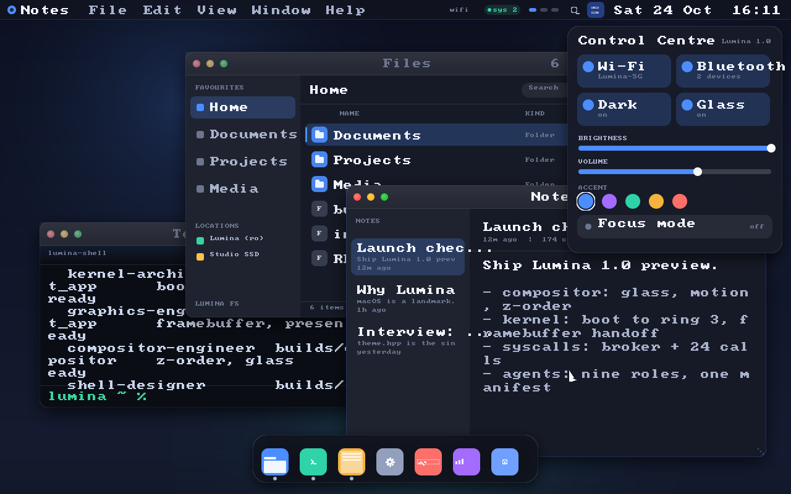
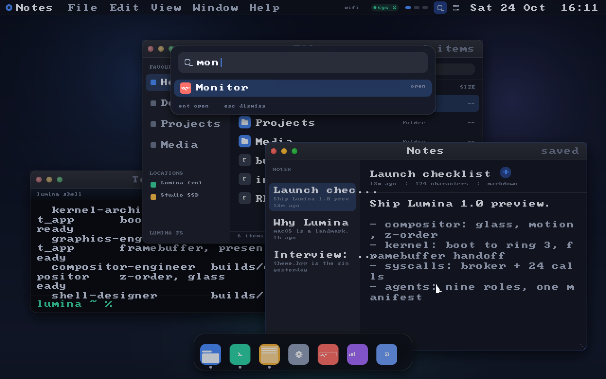
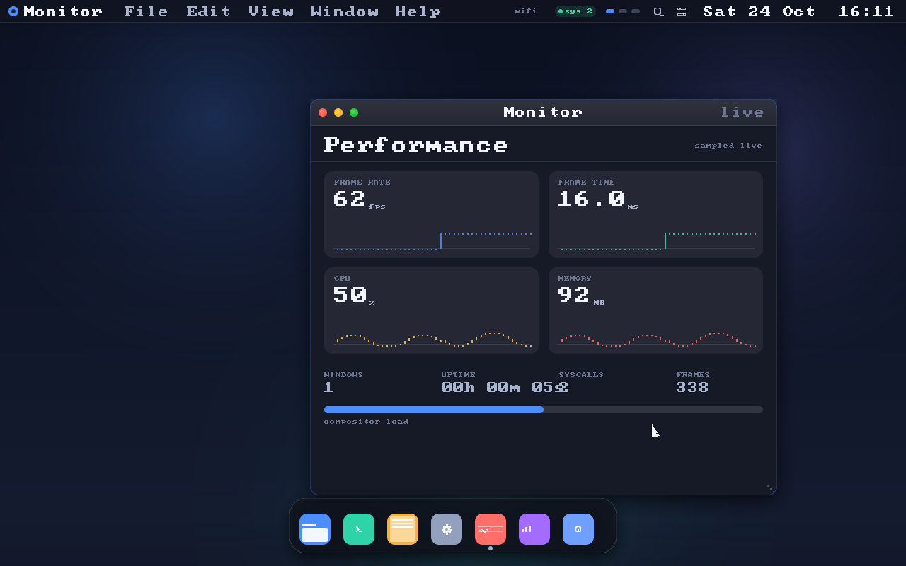
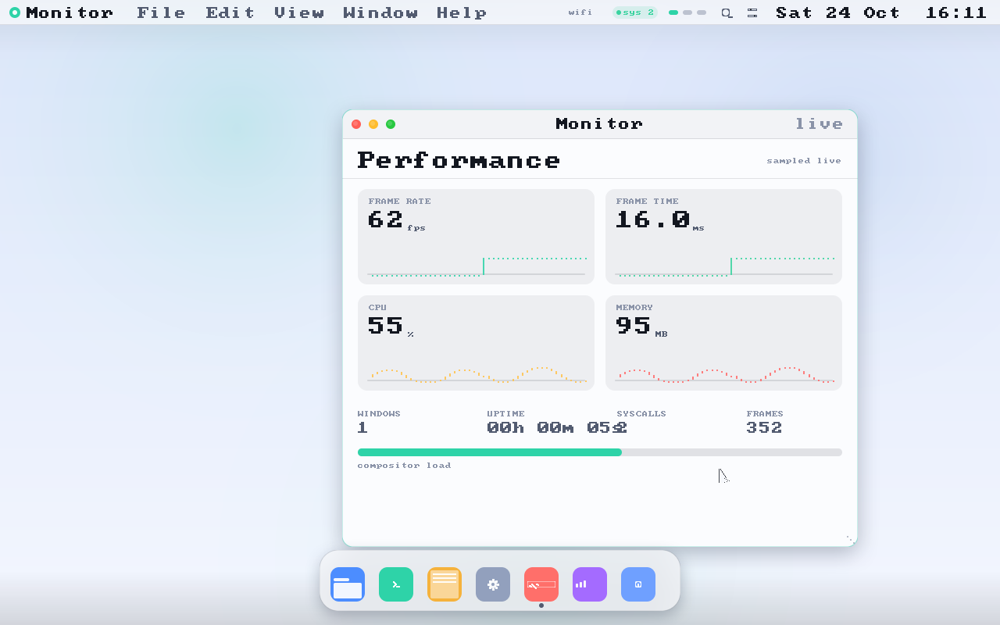
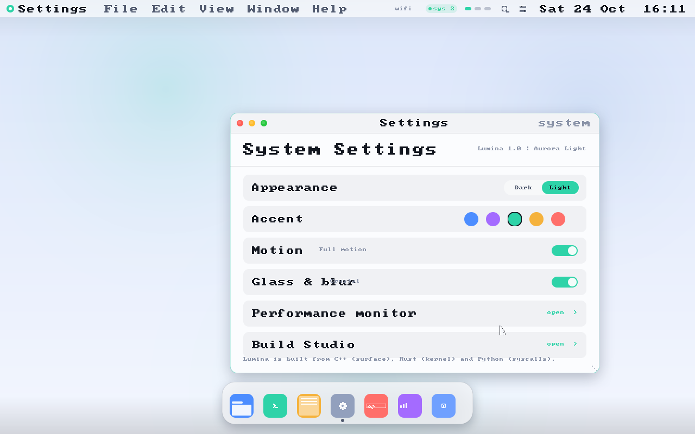
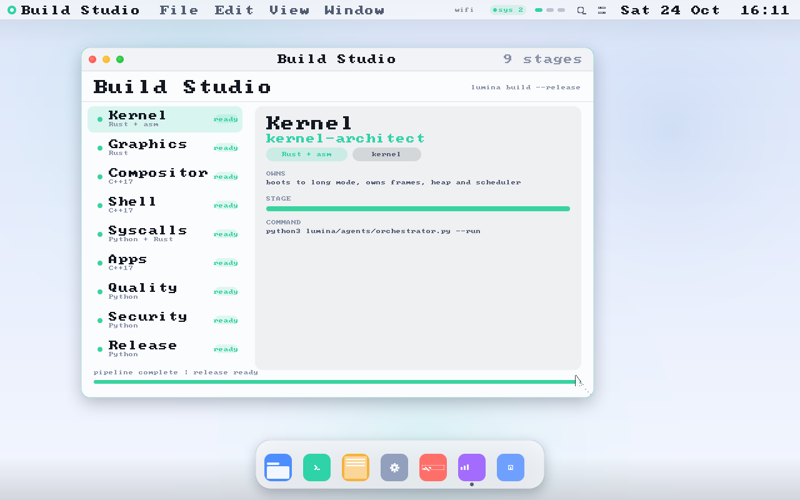

# Lumina OS

**Beyond the Mac.** A desktop operating system built from source in three
languages — **C++17** for the compositor and shell, **Rust** for the kernel,
**Python** for the syscall broker and the build pipeline — with a visual language
that keeps what makes the Mac feel human and replaces what holds it back.



```bash
cd lumina
make                     # build the desktop runtime (g++ + make, nothing else)
make run                 # render the 15-frame still tour into ./out
make test                # 134 checks across rasteriser, windows, apps, shell
make preview             # live desktop on http://0.0.0.0:8080
make kernel              # freestanding Rust kernel + bootable ELF (needs rustup)
```

---

## What is here

| Lane | Languages | What it does |
| --- | --- | --- |
| **Compositor** | C++17 | software rasteriser (antialiased rounded geometry, cached shadows, real frosted blur), window z-order, focus, drag/resize with magnetic edges, spring motion |
| **Shell** | C++17 | menubar with working menus, docking bar with proximity magnification, control centre, spotlight, three workspaces, boot sequence |
| **Apps** | C++17 | Files, Terminal, Notes, Settings, Monitor, About, **Build Studio** |
| **Kernel** | Rust + asm | Multiboot2 → long mode, page tables, GDT/TSS, IDT, PIC/PIT, frame + heap allocators, preemptive scheduler, framebuffer console, `int 0x80` gate |
| **Syscalls** | Python + Rust | 24 typed calls, sandbox policy, budgets, JSONL audit, capability table |
| **Pipeline** | Python | nine agents, one manifest, reproducible commands, verified outputs |
| **Tooling** | Python | `lumctl` control tool, PNG optimiser, image checker |

Everything is dependency-free: the C++ runtime links only libstdc++/libpthread,
the kernel has no crates, and every Python tool is stdlib only.

## Screens

| Boot | Desktop | Windows |
| --- | --- | --- |
|  |  |  |

| Control centre | Spotlight | Monitor |
| --- | --- | --- |
|  |  |  |

| Aurora Light | Settings | Build Studio |
| --- | --- | --- |
|  |  |  |

Fifteen frames live in [`assets/`](assets) — rendered by the shipped binary, not
mocked up.

## Quick start

```bash
# 1. Build and look at it
cd lumina && make && make run && ls out

# 2. Drive it live (mouse + keyboard in a browser canvas)
make preview            # http://0.0.0.0:8080
```

The live server streams raw RGBA frames and accepts pointer/wheel/key events.
`⌘Space` opens spotlight, `⌘,` settings, `⌘1..3` workspaces, `⌘W` closes a
window, `Esc` dismisses overlays. The clock, CPU and RSS figures are real: they
come from the host's `/proc`, not from a canned animation.

```bash
# 3. Inspect the system
python3 tools/lumina/lumctl.py status
python3 tools/lumina/lumctl.py syscalls
python3 tools/lumina/lumctl.py agents
python3 tools/lumina/lumctl.py verify
```

```bash
# 4. Build the kernel (requires rustup: rustup target add x86_64-unknown-none)
make kernel
qemu-system-x86_64 -kernel kernel/build/lumina-kernel.elf -m 256M -serial stdio
```

## The pipeline builds the system

`agents/manifest.json` names nine agents, what each owns, what it emits and which
syscall capabilities it may use. The orchestrator turns that file into a build.

```bash
python3 agents/orchestrator.py --check   # manifest must be true
python3 agents/orchestrator.py --plan    # what runs, in order
python3 agents/orchestrator.py --run     # build, verify outputs, write report
```

```
kernel-architect     Rust    →  kernel       boot · frames · heap · scheduler
graphics-engineer    Rust    →  kernel       framebuffer · boot console
compositor-engineer  C++     →  compositor   surface · z-order · glass · motion
shell-designer       C++     →  lumina-host  menubar · dock · spotlight · spaces
syscall-architect    Py+Rs   →  syscalls     24 typed calls · policy · audit
app-builder          C++     →  compositor   seven first-party apps
qa-engineer          Python  →  syscalls     suites · determinism · CI gate
security-reviewer    Python  →  lumina-host  threat model · capability review
release-manager      Python  →  lumina-host  versioning · artifacts · docs
```

A stage is only `passed` when its commands exit zero **and** its declared outputs
exist. A missing toolchain is reported as `skipped` — never as success.

## Verify

```bash
make test                                                  # 134 C++ checks
python3 tools/lumina/sysd.py --self-test                   # 17 broker invariants
python3 -m unittest discover -s tests -p 'test_*.py'       # 43 Python tests
python3 agents/orchestrator.py --check                     # manifest truth
python3 tools/lumina/lumctl.py verify                      # all lanes
```

The broker's self-test parses `kernel/src/syscall.rs` and fails if the Rust table
and the Python table disagree. The C++ suite renders a scene twice and compares a
64-bit hash of the framebuffer, so a rasteriser regression cannot hide.

## Design

One token file (`include/lumina/theme.hpp`) drives light, dark, five accents,
motion and glass. Apps never choose raw colours; they read the theme.

| Accent | Value | Accent | Value |
| --- | --- | --- | --- |
| Aurora | `#4C8DFF` | Amber | `#F5B23C` |
| Orchid | `#A46BFF` | Coral | `#FF6F6A` |
| Mint | `#2ED3A8` | | |

Read [docs/design-language.md](docs/design-language.md) for metrics, motion
curves and the accessibility commitments.

## Documentation

| Document | Contents |
| --- | --- |
| [docs/architecture.md](docs/architecture.md) | layering, module contracts, boot sequence, data flow |
| [docs/kernel.md](docs/kernel.md) | kernel modules, design decisions, how to boot it, verification status |
| [docs/syscalls.md](docs/syscalls.md) | all 24 calls, errors, policy, audit format |
| [docs/design-language.md](docs/design-language.md) | principles, tokens, metrics, type, glass, accessibility |
| [docs/agents.md](docs/agents.md) | the pipeline, invariants and report format |
| [docs/security-model.md](docs/security-model.md) | trust boundaries, controls, what is *not* covered |
| [docs/threat-model.md](docs/threat-model.md) | actors, threats, mitigations, residual risk |
| [docs/beyond-macos.md](docs/beyond-macos.md) | what Lumina keeps, what it changes, honest comparison |
| [CHANGELOG.md](CHANGELOG.md) | the 1.0 release |
| [THIRD_PARTY_NOTICES.md](THIRD_PARTY_NOTICES.md) | the one borrowed asset (a public-domain font) |

## Status, stated plainly

| Lane | State |
| --- | --- |
| Compositor, shell, apps, host runtime | **built and tested** on Linux with g++ 12 |
| Still tour, live preview, PNG output | **executed** (the screenshots above) |
| Syscall broker, policy, audit | **tested** (17 invariants + unit tests) |
| Agent pipeline | **executed**; Rust stages report `skipped` without `cargo` |
| Rust kernel | **source complete, reviewed; not compiled in this environment** (no Rust toolchain) |
| Bare-metal / ISO boot | **not run**; instructions in [docs/kernel.md](docs/kernel.md) |

Lumina is a working desktop and a real kernel source tree. It is not yet a
laptop you can install; [docs/kernel.md](docs/kernel.md) and
[docs/security-model.md](docs/security-model.md) say exactly where the edge is.

## License

MIT. The embedded 8x8 font is public domain. See
[THIRD_PARTY_NOTICES.md](THIRD_PARTY_NOTICES.md).
